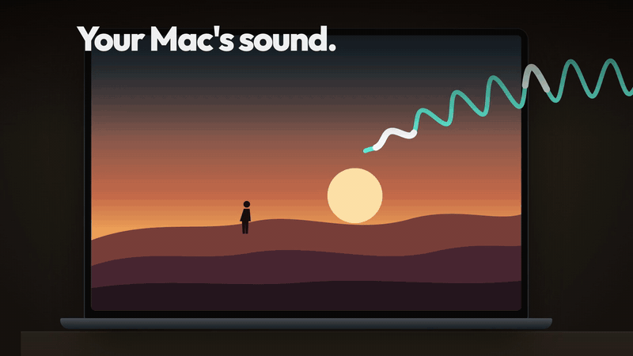
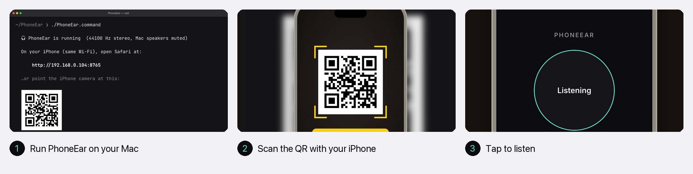

<div align="center">

# PhoneEar

**Watch on your Mac. Hear it in your iPhone's headphones.**

<a href="https://shahirislam.github.io/phoneear/"></a>

[▶ Watch the 32-second launch video (with sound)](https://shahirislam.github.io/phoneear/)


</div>

## How it works



Your Mac's sound streams over Wi-Fi to a web page on your iPhone. The Mac speakers go quiet while it runs.

## Why you'll like it

|  |  |
| --- | --- |
| 📱 **No iPhone app** | It's a web page. Scan the QR code and it opens in Safari |
| 🎧 **Any headphones** | Wired or Bluetooth, whatever's connected to your phone |
| 🤫 **Silent Mac** | The Mac speakers mute automatically and come back when you stop |
| 🎚️ **Self-tuning** | The buffer adapts to your Wi-Fi to keep the sound smooth and the delay low |
| 🪶 **Tiny** | One Swift file, no dependencies, MIT licensed |

## Get started

```bash
brew install shahirislam/tap/phoneear
phoneear
```

<details>
<summary>Or build from source</summary>

```bash
git clone https://github.com/shahirislam/phoneear.git
cd phoneear
./PhoneEar.command
```

Or double-click **`PhoneEar.command`** in Finder. Needs Xcode Command Line Tools (`xcode-select --install`).

</details>

Then scan the QR code with your iPhone, tap **Tap to listen**, and press <kbd>Ctrl</kbd>+<kbd>C</kbd> on the Mac when you're done.

| Option | What it does |
| --- | --- |
| `--keep-mac-audio` | Play on the Mac speakers too |
| `--port 9000` | Use a different port (audio uses port + 1) |

## Good to know

- **First run:** macOS asks for permission to record system audio. If you only hear silence, open *System Settings → Privacy & Security → Screen & System Audio Recording → System Audio Recording Only*, turn on your terminal app, and restart PhoneEar.
- **Keep the phone screen on.** Safari pauses audio when the iPhone locks, so set *Auto-Lock* to *Never* while you watch.
- **Lip sync:** the sound runs roughly 100–200 ms behind the picture. In IINA or VLC, set the audio delay to about −150 ms.
- **Choppy sound?** Use 5 GHz Wi-Fi, or turn on the iPhone's Personal Hotspot and join it from the Mac.

## Under the hood

A Core Audio process tap captures the Mac's mixed output (and mutes the speakers). A tiny built-in server streams 16-bit PCM over a WebSocket to the page, and Web Audio plays it through an adaptive jitter buffer. It's all in [`Sources/main.swift`](Sources/main.swift).


## License

[MIT](LICENSE) © 2026 Shahir Islam
